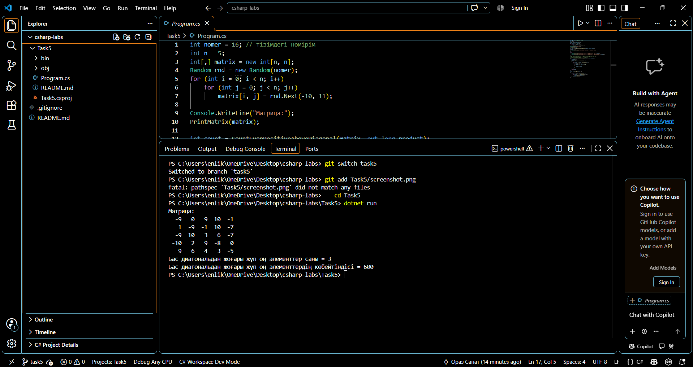

# 5-тапсырма: Екі өлшемді массивтер (нұсқа 1)

Нұсқа 1: бас диагональдан жоғары орналасқан (j > i) жұп оң элементтердің көбейтіндісі мен санын табу. Ондай элемент болмаса, бағдарлама ол туралы хабар шығарады.

`nomer = 16`, матрица `new Random(16)` арқылы толтырылған.

| Тест | Кіріс | Қолмен есептеген жауап | Бағдарлама жауабы |
|---|---|---|---|
| Жеке тест | Random(16) | Диагональдан жоғары жұп оң элементтер: 10, 10, 6. Саны = 3, көбейтіндісі = 600 | Саны = 3, көбейтіндісі = 600 |
| Өз тестім 1 | Random(1) | Жұп оң элементтер: 6, 10, 4, 4. Саны = 4, көбейтіндісі = 960 | Саны = 4, көбейтіндісі = 960 |
| Өз тестім 2 | Random(36) | Диагональдан жоғарыда жұп оң элемент жоқ (0 оң сан емес) | «Бас диагональдан жоғары жұп оң элементтер жоқ.» |

Өз тесттерімде `Program.cs` ішіндегі `nomer` мәнін уақытша өзгертіп іске қостым, содан кейін 16-ға қайтардым.

## Сұрақтарға жауап

1) `matrix[i, j]` жазбасында `i` жол нөмірін, `j` баған нөмірін білдіреді, екеуі де 0-ден басталады. `matrix.GetLength(0)` жолдар санын, `matrix.GetLength(1)` бағандар санын қайтарады, менің матрицамда екеуі де 5.

2) Диагональдан жоғары элементтерді `j > i` шарты арқылы таңдадым: әр `i` жолында ішкі циклді `j = i + 1`-ден бастаймын. Бас диагональдың өзінде `i == j` болады, ал шарт қатаң (`>`), сондықтан диагональ элементтері кірмейді.

3) Есепті шығаратын `CountEvenPositiveAboveDiagonal` әдісіндегі ішкі цикл `i = 0` кезінде 4 рет, `i = 1` кезінде 3, `i = 2` кезінде 2, `i = 3` кезінде 1, `i = 4` кезінде 0 рет орындалады. Барлығы 4 + 3 + 2 + 1 + 0 = 10 рет. Салыстыру үшін, матрицаны толтыру мен шығаруда ішкі цикл 5 · 5 = 25 реттен орындалады.

## ЖИ қолдану

Жасанды интеллект (Claude) қолданылды.

- Сұрау: тапсырма PDF-ін беріп, Ораз Санат үшін (тізімдегі нөмір 16, 5-тапсырма нұсқасы 1) 1-бөлімді орындауды сұрадым.
- Не жасалды: Claude Git репозиторийін, `.gitignore` мен түбірдегі README-ді, `Program.cs` кодын (матрица, `PrintMatrix`, нұсқаның әдісі) және осы есептің жобасын жазды.
- Тексеру: Claude бұл ортада .NET жоқ болғандықтан, `Random(seed)` алгоритмін Python-да қайталап, күтілетін нәтижелерді есептеді. Қолмен есептеген жауаптар шығарылған матрицаның диагональдан жоғары элементтерін бір-бірлеп қарап табылды.
- Кодқа енгізген өзгерісім: (мұнда өзіңіз не өзгерткеніңізді жазыңыз)
