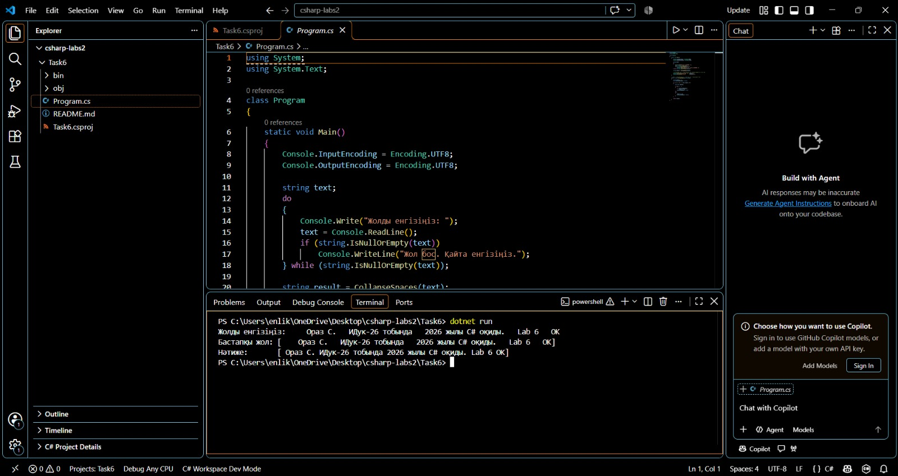

# 6-тапсырма: Символдар тіркесі (нұсқа 3)

Тапсырма: қатар тұрған бірнеше бос орынды бір бос орынмен алмастыру.



| Тест | Кіріс | Қолмен есептеген жауап | Бағдарлама жауабы |
|---|---|---|---|
| Жеке тест | `Ораз С. Идук-26 тобында 2026 жылы C# оқиды. Lab 6 ОК`, басында, ортасында бірнеше бос орын | `[ Ораз С. Идук-26 тобында 2026 жылы C# оқиды. Lab 6 ОК]` | `[ Ораз С. Идук-26 тобында 2026 жылы C# оқиды. Lab 6 ОК]` |
| Өз тестім 1 | `jh` (бос орын жоқ) | `[jh]` | `[jh]` |
| Өз тестім 2 | `a    b` (4 бос орын) | `[a b]` | (іске қосып жазыңыз) |

Ескерту: жолдың басындағы бос орын толық жойылмайды, біреуіне дейін қысқарады, себебі тапсырма тек қатар тұрған бос орындарды біреуіне ауыстыруды сұрайды.

## Сұрақтарға жауап

1) `text[i]` жолдың i-ші символын қайтарады, оның типі `char`. `text[i] = 'a';` деп жазуға болмайды, себебі C#-та `string` өзгермейтін (immutable) тип: символды орнында өзгертуге болмайды, тек жаңа жол жасауға болады.

2) Алдыңғы символдың бос орын болғанын `previousWasSpace` деген `bool` айнымалысы есте сақтайды. Бос орын кезіккенде, егер `previousWasSpace == false` болса, оны нәтижеге қосамын да, айнымалыны `true` етемін. Бос емес символ кезіккенде айнымалыны `false` қайтарамын. Сондықтан қатар тұрған бос орындардың біріншісі ғана қосылады.

3) `result += ch;` орындалғанда ескі жол өзгермейді, жаңа жол жасалады: ескі `result` пен `ch` біріктіріліп, жаңа жолға жазылады да, `result` айнымалысы соған көрсетеді. Ұзын жолдарда бұл баяу, сондықтан `StringBuilder` тиімдірек.

## Кездескен қате

Қате: бағдарламаны іске қосқанда `You must install or update .NET to run this application`: жоба `net8.0` үшін жазылған, ал компьютерде тек .NET 10.0.12 орнатылған.
Қалай түзеттім: `Task6.csproj` ішінде `<TargetFramework>net8.0</TargetFramework>` жолын `net10.0` деп өзгерттім.
Түзеткен коммит: (git log-тан хэшті жазыңыз, мысалы a1b2c3d)

## Git

`git log --oneline --graph --all` командасының нәтижесі:

```
(осы жерге көшіріп қойыңыз)
```

1) task6 тармағындағы коммиттер GitHub-та Pull Request арқылы main тармағына біріктірілді. Біріктіруден кейін task6 тармағы өшірілмей қалды, ол Branches бөлімінде көрінеді.

2) `commit` өзгерістерді тек компьютердегі жергілікті тарихқа сақтайды, ал `push` оларды GitHub-қа жібереді. Push жасамасам, мұғалім GitHub-та ештеңе көрмейді.

3) `.gitignore` файлына `bin/` және `obj/` қалталары кіреді. Олар `dotnet build` кезінде автоматты жасалатын уақытша файлдар, оларды кез келген компьютерде қайта құруға болады, сондықтан репозиторийге қажет емес.